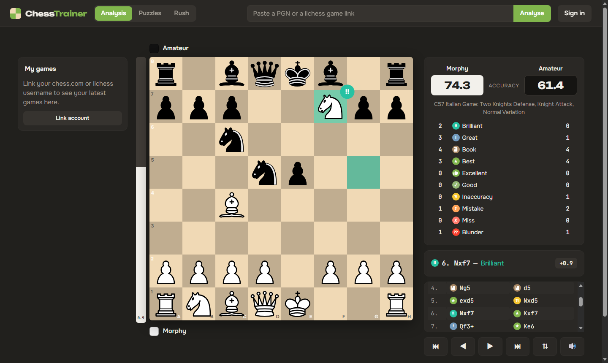
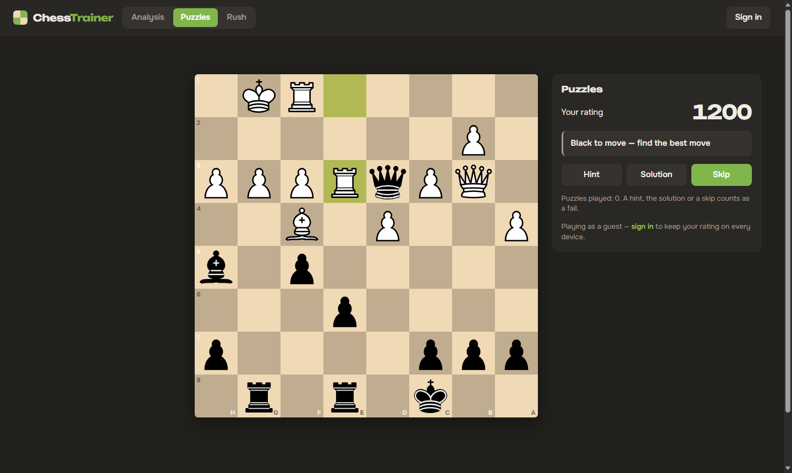
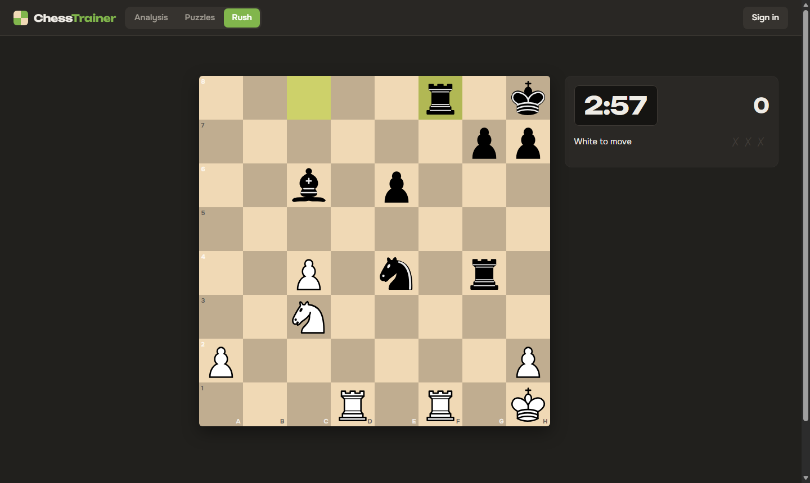
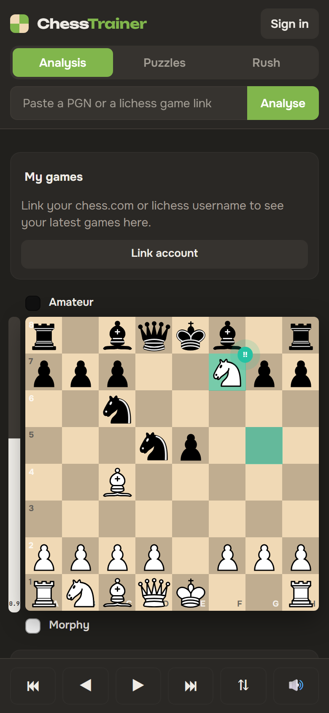

<div align="center">


# ChessTrainer

**Free chess game analysis, rated puzzles and Puzzle Rush, in the browser.**

Stockfish 17 grades every move the way chess.com Game Review does, from **Brilliant** to **Blunder**.

[**Open chess.thekeq.com →**](https://chess.thekeq.com)



</div>

## Features

**Game analysis**
- Load a game by pasting a PGN or a lichess link. You can also link your chess.com or lichess username and pick from your latest games.
- Every move is graded as Brilliant, Great, Book, Best, Excellent, Good, Inaccuracy, Mistake, Miss or Blunder. Each grade gets a badge on the board, and Brilliant moves get an animation.
- Both players get an accuracy score, calibrated against chess.com (see [how it works](#how-it-works)).
- The board shows an eval bar, a best-move arrow and the opening name, and plays sounds.
- You can play your own moves from any position. The engine grades each one instantly, and your moves form a variation you can step through.
- Right-drag draws arrows, right-click highlights a square and left-click clears the board, like on chess.com.

**Puzzles**
- 23,781 puzzles from real games, from the lichess puzzle database, rated 400 to 2800.
- Your puzzle rating is an Elo rating. Puzzles are picked near it, so they get harder as you improve.
- Hint, solution and skip buttons. Any mating move counts, as on lichess.

**Puzzle Rush**
- 3 minutes and three strikes. Short puzzles get harder with every one you solve, and your best score is kept.

**Accounts are optional**
- Guests can use everything. Their progress lives in a signed session cookie.
- Creating an account carries guest progress over and syncs it across devices.

<table>
  <tr>
    <td width="50%"></td>
    <td width="50%"></td>
  </tr>
  <tr>
    <td align="center"><sub>Rated puzzles</sub></td>
    <td align="center"><sub>Puzzle Rush</sub></td>
  </tr>
</table>

<p align="center"></p>

## How it works

- **The engine runs in your browser.** Desktops get the full multi-threaded [Stockfish 17.1](https://github.com/nmrugg/stockfish.js) (WASM, 2 threads, 0.5 s per position). Phones get the lite single-threaded build. The server never runs an engine, so it's fine on a 1 vCPU / 1 GB VPS.
- **Move grades** follow chess.com's expected-points thresholds: win-probability loss of 0.02, 0.05, 0.10 and 0.20.
  - **Brilliant:** a sound sacrifice. The piece is left en prise even though another move would have saved it.
  - **Great:** the only good move.
  - **Miss:** failing to punish the opponent's mistake.
  
  chess.com's exact rules are private, so these are heuristics.
- **Accuracy** was fitted against chess.com's own accuracy on 40 reviewed games. It uses per-move accuracy on a flatter win-probability curve plus a power mean, so blunders weigh more. The mean absolute error is about 3 points, against about 15 for a plain mean.
- **Book moves** come from the [lichess chess-openings](https://github.com/lichess-org/chess-openings) dataset. **Puzzles** are a curated subset of the [lichess puzzle database](https://database.lichess.org/#puzzles): popular, often played, with a settled rating, evenly spread by rating. `tools/build_puzzles.py` rebuilds the subset.

## Tech stack

| | |
|---|---|
| Backend | Python, Flask, [python-chess](https://python-chess.readthedocs.io), SQLite |
| Frontend | One `index.html`, plain JS modules, no build step |
| Board | [chessground](https://github.com/lichess-org/chessground) (lichess) |
| Rules in the browser | [chess.js](https://github.com/jhlywa/chess.js) |
| Engine | [Stockfish 17.1 WASM](https://github.com/nmrugg/stockfish.js) |

## Run locally

```bash
git clone https://github.com/Thekeq/chess-analyzer && cd chess-analyzer
python -m venv .venv && .venv/bin/pip install -r requirements.txt   # Windows: .venv\Scripts\pip
.venv/bin/python app.py                                              # http://localhost:5000
python analysis.py                                                   # self-check, prints "ok"
```

`var/` is created on first start. It holds the SQLite database and the session key, and is not tracked by git.

## Deploy

On any small Linux box, behind nginx or a Cloudflare Tunnel:

```bash
git clone https://github.com/Thekeq/chess-analyzer /opt/chess-analyzer && cd /opt/chess-analyzer
python3 -m venv .venv && .venv/bin/pip install -r requirements.txt
mkdir -p var && chown www-data:www-data var
```

`/etc/systemd/system/chess.service`:

```ini
[Unit]
Description=chess-analyzer
After=network.target

[Service]
WorkingDirectory=/opt/chess-analyzer
ExecStart=/opt/chess-analyzer/.venv/bin/gunicorn -w 2 --threads 4 -b 127.0.0.1:8787 app:app
Restart=always
User=www-data

[Install]
WantedBy=multi-user.target
```

```bash
systemctl daemon-reload && systemctl enable --now chess
```

Then point a tunnel or proxy at `localhost:8787`. Multi-threaded Stockfish needs `SharedArrayBuffer`, and the app enables it with `Cross-Origin-Opener-Policy` and `Cross-Origin-Embedder-Policy` headers. If a proxy serves `/static/` itself, it must send those headers too.

To update: `git pull && systemctl restart chess`.

## Project layout

```
app.py                 Flask app: game import, report, live move grading, puzzles, accounts
analysis.py            move classification, sacrifice detection, accuracy (+ self-check)
static/index.html      the whole UI
static/engine/         Stockfish 17.1 WASM (full + lite)
static/vendor/         chessground, chess.js
data/openings.tsv      lichess opening book
data/puzzles.csv.gz    puzzle subset
tools/build_puzzles.py rebuilds the puzzle subset from the lichess dump
```

## Credits and licenses

ChessTrainer is licensed under the **[GNU GPL v3](LICENSE)**, the same as Stockfish and chessground, which it bundles.

- [Stockfish](https://stockfishchess.org) and the [stockfish.js](https://github.com/nmrugg/stockfish.js) WASM build: GPL-3.0
- [chessground](https://github.com/lichess-org/chessground): GPL-3.0
- [chess.js](https://github.com/jhlywa/chess.js): BSD-2-Clause
- [lichess puzzle database](https://database.lichess.org/#puzzles) and [chess-openings](https://github.com/lichess-org/chess-openings): CC0
- Fonts: [Onest](https://fonts.google.com/specimen/Onest), [Unbounded](https://fonts.google.com/specimen/Unbounded), [JetBrains Mono](https://www.jetbrains.com/lp/mono/), all SIL OFL 1.1
- Move sounds: © chess.com

Not affiliated with chess.com or lichess.
